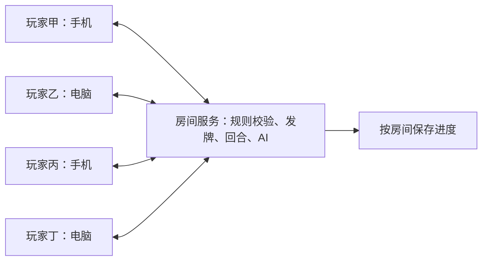

# 掼蛋多人联机可行性研究

研究日期：2026-11-02。代码基线：`f4c4fdd`，产品版本 `1.24.6`。

实施更新：v1.25.0 已增加独立的 Wi-Fi 和公网联机入口、房间服务与部署配置；使用方式见 [联机说明](online-play.md)。以下保留实施前的研究依据。

本文是基于现有代码和官方文档的研究结论。当前产品仍为单机版；本文没有新增可用的联机入口或部署服务。

## 结论与玩家体验

可以在现有项目上增加多人联机，规则、牌型判断、AI 和桌面／手机界面有较多可复用部分。建议采用 **Node.js + Socket.IO 房间服务，由服务端统一维护对局**，客户端提交操作并显示服务端返回的结果。

建议的使用流程：

1. 首页选择「好友联机」，输入昵称并创建房间。
2. 房主分享邀请链接、房间号或二维码，朋友用手机或电脑浏览器加入。
3. 玩家选择座位，相对而坐的两人组队；全部准备后开始。
4. 支持四名真人，也支持两／三名真人加电脑补位。电脑和托管由服务端驱动。
5. 刷新或短暂掉线后回到原座位，恢复当前牌桌；不必重新开局。

第一版可用昵称和设备上的重连凭据进入，无需先建立账号体系。旁观、公开匹配、排行榜、聊天与语音不必纳入首次联机交付。

## 同一 Wi-Fi 与异地游玩

| 场景 | 运行方式 | 玩家操作 | 需要什么 |
| --- | --- | --- | --- |
| 同一 Wi-Fi | 一台电脑运行房间服务，同时提供网页 | 访问该电脑的局域网地址，再加入同一房间 | 电脑保持开机；设备间网络可达；服务监听局域网接口 |
| 异地／手机流量 | 房间服务部署在公网 | 打开 HTTPS 链接，输入房间号或点邀请链接 | 支持常驻 Node.js 和实时连接的服务器、HTTPS |
| 单机离线 | 继续使用现有单机入口 | 本机打开或使用已缓存的网页 | 无需房间服务 |

两种联机场景可以使用同一套对局代码，区别主要在服务部署地址。同一 Wi-Fi 游玩不要求公网连接，但设备仍须能连接房间服务；手机热点／访客网络是否允许设备互访要实测。

当前 `启动.command` 只把 Python 静态服务绑定到 `127.0.0.1`。即使改为局域网可访问，也只是让多台设备下载网页，每台设备仍会分别开一场单机游戏。

现有 GitHub Pages 可以继续提供静态前端，但无法单独承担房间计算：它提供的是静态网站托管。[GitHub Pages 官方说明](https://docs.github.com/en/pages/getting-started-with-github-pages/what-is-github-pages)。初期让同一个 Node 服务提供网页与联机接口，可减少跨域和版本配套工作；以后再按需要分离。

公网网页和实时连接分别使用 HTTPS 与 WSS。局域网通过普通 HTTP 打开网页时，不应承诺现有 PWA 离线安装能力；Service Worker 要求安全上下文，普通局域网 IP 的 HTTP 地址不属于 localhost 开发例外。[WebSocket 客户端说明](https://developer.mozilla.org/en-US/docs/Web/API/WebSockets_API/Writing_WebSocket_client_applications)、[Service Worker 官方说明](https://developer.mozilla.org/en-US/docs/Web/API/Service_Worker_API)。

## 为什么选择房间服务

| 方案 | 对本项目的适用性 | 主要代价 | 建议 |
| --- | --- | --- | --- |
| Node.js + Socket.IO | 同语言复用规则；提供事件通信、房间分组与连接恢复能力 | 需要运行一个后端，并实现游戏层的同步逻辑 | 优先采用 |
| Node.js + 原生 WebSocket／`ws` | 同样可行，传输层较薄 | 房间、心跳、重连、确认与恢复协议需要自行组合 | 可作为已有相关基础设施时的替代 |
| WebRTC，玩家设备担任主机 | 适合明确需要设备直连的产品 | 联网通常仍需信令及 STUN／TURN；还要处理主机退出、手机后台和完整手牌由谁保管 | 第一版不优先 |

Socket.IO 支持双向事件通信及房间内分组广播；这里的“游戏房间”仍要由项目实现座位、准备、对局状态与生命周期，不能把传输库的房间频道直接当成游戏逻辑。[Socket.IO 简介](https://socket.io/docs/v4/)、[Rooms](https://socket.io/docs/v4/rooms/)。

WebRTC 的连接建立需要交换信令，ICE 通常使用 STUN／TURN。它可以用于数据传输，但“采用 WebRTC 就完全不用任何服务器”不适合作为本项目的默认承诺。[WebRTC 官方连接说明](https://webrtc.org/getting-started/peer-connections)。

以上选择是结合当前代码规模、四人回合制玩法与改造成本作出的工程判断，不是性能压测结论。首次上线可从单进程、多房间开始，暂不引入分布式房间和跨节点迁移。

## 代码中可以复用什么

| 当前模块 | 已有能力 | 联机改造边界 |
| --- | --- | --- |
| `js/cards.js`、`js/rules.js` | 两副牌模型、配牌、牌型、压牌与合法动作枚举 | 浏览器和服务端共用同一份规则 |
| `js/game.js` | 四座位状态、出牌、接风、结算、升级、进贡／还贡 | 提取可在 Node 中使用的对局内核；注入持久化和随机源 |
| `GD.observe.build/serialize` | 对指定座位生成手牌与公开信息视图 | 复用信息隔离思路，为网络另建明确字段白名单 |
| `js/ai.js`、`ai-memory.js`、`ai-search.js` | 现有电脑决策、记牌与采样 | 用于服务端电脑补位／托管；异步计算结果提交前再次校验回合 |
| `js/ui.js` | 桌面与手机共用的牌桌交互、反馈、语音和特效 | 把操作提交、对局推进与渲染分开，适配网络状态 |
| `js/table-view.js`、`js/stats.js`、`js/flow.js` | 视图、个人战绩、异步操作有效性检查 | 去除“真人永远是座位 0”的联机假设 |
| `js/turn-clock.js` | 本地 30 秒展示，归零不自动出牌 | 联机显示服务端统一的回合截止时间；超时行为由房间规则决定 |

本次做了不经过网络的可行性检查：通过项目现有 Node 测试加载方式，成功创建四人牌局、生成四个各含 27 张自己手牌的序列化观察视图；错误座位出牌被拒绝且状态不变；正确座位出牌后状态版本推进，完整状态校验通过。

这证明内核具备复用基础，不能替代真实多设备联机测试。本轮未取得全量回归通过结果，也未进行真实多设备或弱网测试。当前文件仍通过 `window.GD` 组织模块，对局函数还直接调用 `localStorage` 存档和本地战绩；正式后端应把这些依赖分离，而非用共享的假浏览器存储长期承载多个房间。

## 服务端与客户端如何配合

服务端保管完整四家手牌，统一洗牌、发牌、判断操作是否合法并推进回合。浏览器只提交意图，例如“出这些牌”“不要”“进贡这张牌”，不提交一份由浏览器自行决定的新局面。联机洗牌在服务端使用不可预测的随机源，客户端不接收可重建发牌的种子。

每次操作后，分别给四名玩家发送各自可见的视图：自己的手牌、其他人的张数、桌面公开牌、当前回合、级数、结算和公开出牌记录。四人回合制第一版可以发送完整的个人视图，先保证易于校正状态；之后有实际数据再考虑增量优化。

公共操作事件可以向整桌广播；含手牌的个人视图要逐人发送。不能把完整 `state.hands` 广播后再用 CSS 隐藏。现有 AI 观察对象也不是直接可用的网络牌桌协议：其中的封闭手牌 Proxy 不适合作为传输格式，现有序列化内容也不包含所有界面所需的桌面与房间信息。

建议协议至少包括：

| 消息 | 用途 |
| --- | --- |
| `room:create/join/ready/start` | 创建、加入、准备与开局 |
| `game:play/pass/give/return` | 出牌、过牌与进贡／还贡 |
| `game:autopilot` | 申请或取消本人座位托管 |
| `session:resume` | 验证重连凭据并恢复原座位 |
| `room:view`、`game:view` | 房间状态和接收者专属对局视图 |
| 操作确认／拒绝 | 返回请求编号、处理结果和当前版本 |

命名是建议，尚无实现。操作建议携带 `requestId`、`matchId`、`handId` 和 `expectedRevision`；座位身份由服务端连接会话决定。服务端按房间串行处理，对重复请求返回原结果，对旧局面请求拒绝并下发新视图。客户端根据确认结果更新牌桌，断线期间停用提交。

Socket.IO 默认提供的是至多一次消息投递，不能自行保证每次出牌都成功到达；启用重试后还需要请求去重。其连接状态恢复也可能失败，因此始终保留“验证身份后重新获取完整个人视图”的路径。[投递保证](https://socket.io/docs/v4/delivery-guarantees/)、[连接状态恢复](https://socket.io/docs/v4/connection-state-recovery/)。

不要直接把现有 `state.gen` 当作覆盖所有网络状态变化的版本号：`act` 等路径会递增，但 `continueAfterHand` 和 `finishAnti` 当前并不统一递增。建议由房间层单独维护单调递增的 `revision`，覆盖开局、换副、抗贡结束、托管切换等变化。

## 需要明确调整的单机行为

- **座位视角**：服务端固定真实座位 0–3；每个客户端按自己的座位旋转展示，让本人始终在底部。不要通过复制或重排完整服务端状态改变真实座位。现有 UI 的 `hands[0]`、`awaiting.seat === 0` 以及队伍／语音映射需要一起适配。
- **手牌观战**：当前自己出完后直接显示 `hands[2]`。联机时应明确房间是否允许出完看对家；允许时，由服务端只向符合条件的已出完队友开放，其他玩家和外部旁观者不会因此获得手牌。
- **菜单与竖屏**：当前开菜单／弹窗会暂停本地对局，手机版转竖屏会触发暂停按钮。联机时这些动作只影响该玩家的界面，整桌仍按服务端时钟推进；需要全桌暂停时另设明确的房间规则。
- **倒计时**：现有 30 秒是提醒，归零后仍可出牌。建议联机使用统一截止时间，并明确采用超时托管、宽限等待或房间约定，不能让四台设备各自计时和代打。
- **掉线与退出**：短暂掉线保留座位；超时后由服务端按房间规则托管；重连后在确定的操作边界交还控制权，避免真人和旧 AI 回调各出一次。房主是管理角色，关闭房主网页不应让其他玩家对局消失。
- **存档与恢复**：联机对局进度按房间保存在服务端，浏览器保留个人设置和重连凭据。内存保存能应对客户端刷新，不能应对服务进程重启；若承诺后端重启后续局，需要保存快照、版本、座位会话和必要的去重结果。
- **下一副与战绩**：由服务端统一结算、收集继续准备并发下一副；个人胜负根据真实座位所属队伍计算，不能沿用只统计座位 0 的逻辑。
- **缓存和版本**：桌面、手机的缓存资源要包含新增联机脚本；离线提示应区分单机和联机。连接时核对协议／规则版本，防止旧缓存客户端使用不匹配的操作格式。

## 建议验证顺序与交付标准

先用一台本地房间服务，跑通四个独立浏览器会话的「建房 → 入座 → 准备 → 同一副牌 → 出牌 → 结算」。这一阶段验证网络与座位视角，不以“多个页面都能打开”作为联机完成。

随后接入完整升级对局、进贡／还贡、两／三真人加电脑、断线恢复和超时处理，再使用同一套服务验证公网、手机流量以及桌面／手机混合游玩。购买哪种服务器和并发容量，应根据实际玩家位置、房间数与 AI 负载再确认；本次没有压测或费用测算。

可用联机版应至少验证：

1. 四个隔离会话进入同一房间，看到同一回合；四人的本人手牌互不重叠，初始合计 108 张。
2. 网络响应、浏览器存储和调试状态不包含未授权的其他人手牌；房间间的数据彼此隔离。
3. 重复点击、丢失确认后的重试、延迟到达的旧操作，都只产生一次有效出手或被明确拒绝。
4. 出牌、接风、单／双贡、抗贡、升级、过 A 和换副在所有设备上一致。
5. 任一玩家刷新、断网重连、切后台、转竖屏或打开设置，不会暂停或重置其他人的牌局。
6. 真人操作、倒计时和 AI 托管同时到达时，只有符合当前版本的一个操作生效。
7. 如果承诺服务重启后续局，重启服务后仍能恢复牌局、座位与手牌；如果未提供持久化，界面要准确说明恢复范围。
